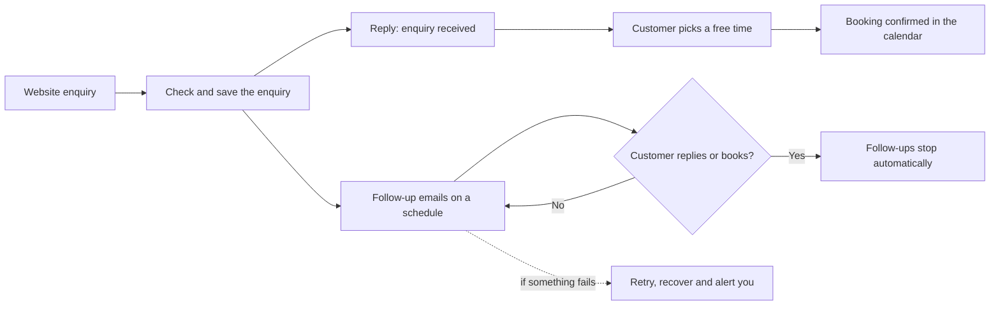
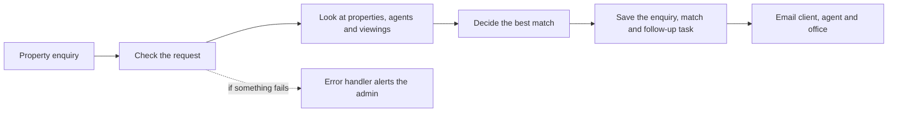
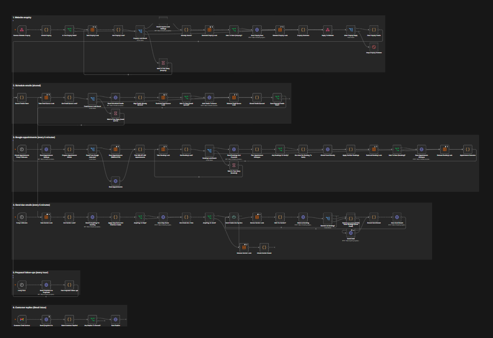
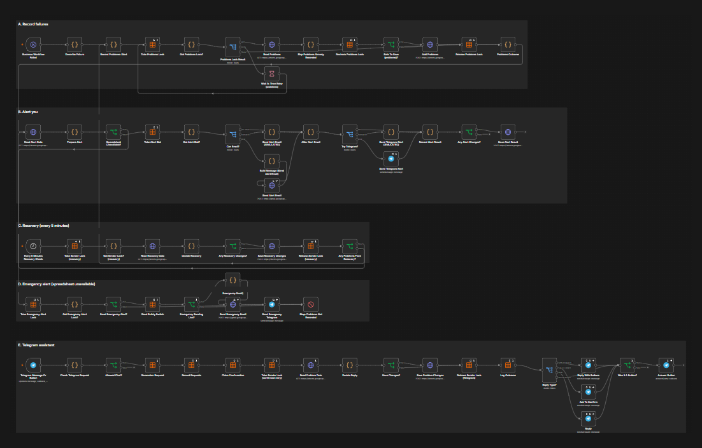
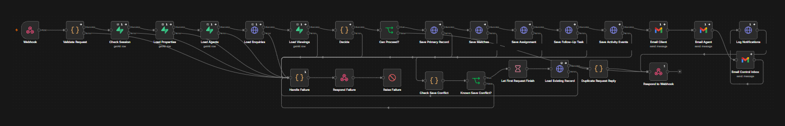
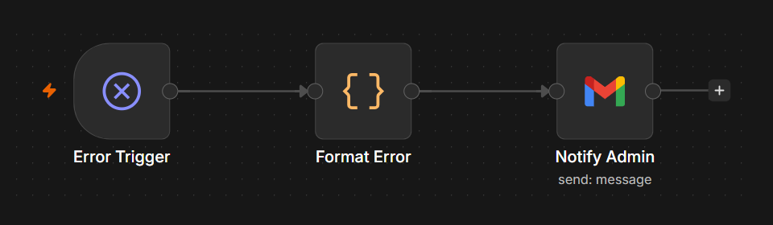

# Business Automation Suite

**Two automations that turn website enquiries into organised, followed-up customers, without anyone having to remember to do it.**

    

---

## The problem

Most enquiries are lost for ordinary reasons: the message sits unread, nobody follows up, a call gets double-booked, or something quietly fails and nobody notices. Each lost enquiry is lost revenue.

## Who it's for

Service businesses that take enquiries through a website and want every one handled quickly and consistently, from the first message to a booked call or viewing.

## The two automations

### 1. Enquiry, booking and follow-up automation

A new enquiry is captured, acknowledged, followed up automatically, and turned into a booked call, with a safety net if anything goes wrong.

- **Saved first:** the enquiry is stored before anything else happens, so an email problem can never lose it
- **Automatic follow-ups:** emails go out on a schedule and stop on their own when the customer replies, books, or the deal is won or lost
- **Smart booking:** customers pick from times that are genuinely free, based on working hours and the calendar
- **No double-booking:** a time that is taken can't be booked twice, even if two people try at once
- **Self-service changes:** customers can cancel or reschedule from a secure link, with no account needed
- **Recovery and alerts:** failed emails are retried, stuck bookings are released, and you get one clear alert (email, with Telegram as a backup) if something needs you

### 2. Real-estate lead-to-viewing automation

Built for a real-estate agency: a property enquiry comes in and is matched to the right property and agent, with follow-up tasks created and the right people notified.

- **Instant handling:** every enquiry is checked and recorded as soon as it arrives
- **Right agent, right property:** enquiries are matched against current properties and agents
- **Follow-up tasks:** a follow-up task is created so no lead is forgotten
- **Everyone informed:** the client, the agent and the office all get an email
- **Safe against duplicates and failures:** repeat submissions are recognised, and any failure sends an alert instead of being lost

## Screenshots

*The automations as built in n8n. Private details have been removed from the images.*

**Enquiry, booking and follow-up workflow**

**Safety net: error alerts and recovery**

**Real-estate lead-to-viewing workflow**

**Real-estate error handler**

## Results

- The enquiry, booking and follow-up automation is a workflow of **80+ steps** with built-in safeguards, including saving enquiries first and preventing double-booking
- The automated test suites pass in full: **164 of 164** checks for the enquiry and booking logic, and **91 of 91** checks for the real-estate workflow

*Business results (response times, bookings, time saved) will be added here once confirmed.*

## Built with

`n8n` · `Gmail` · `Google Calendar` · `Google Sheets` · `Supabase` · `Telegram Bot`

## Want something like this?

I build automations like this for businesses: lead capture, follow-ups, and alerts. Get in touch at [walkflow.tech](https://walkflow.tech) or on [LinkedIn](https://linkedin.com/in/walkflow).

---

This repository is a showcase. A live demo is available on request — contact me via walkflow.tech or LinkedIn.
